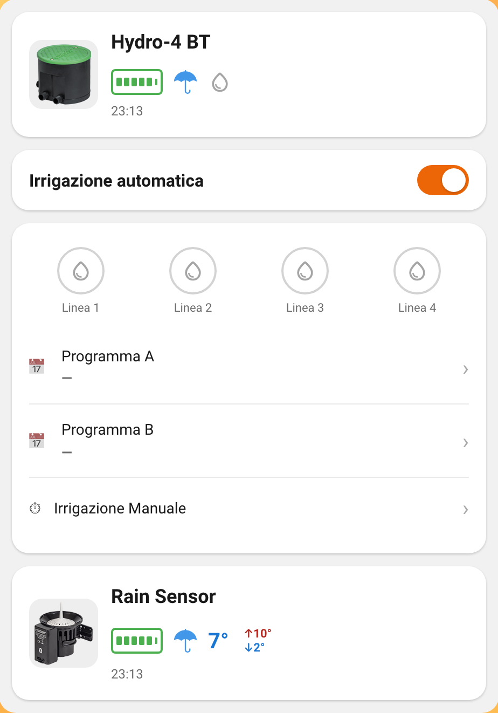
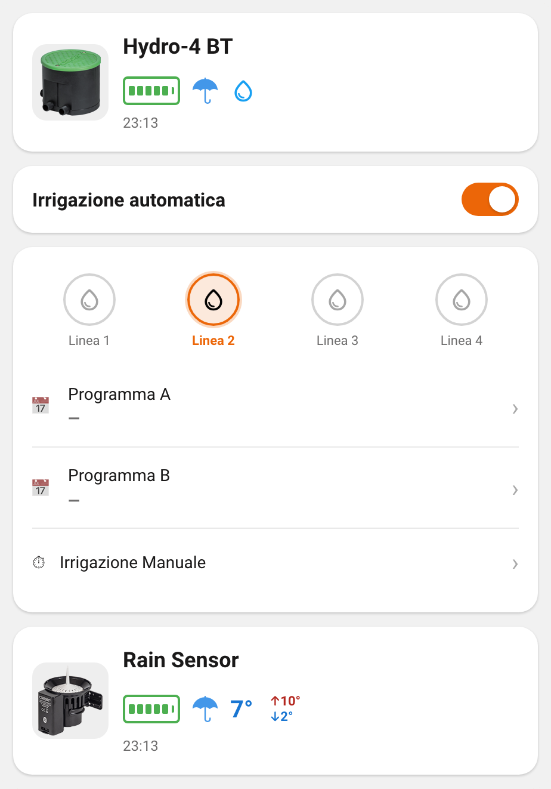
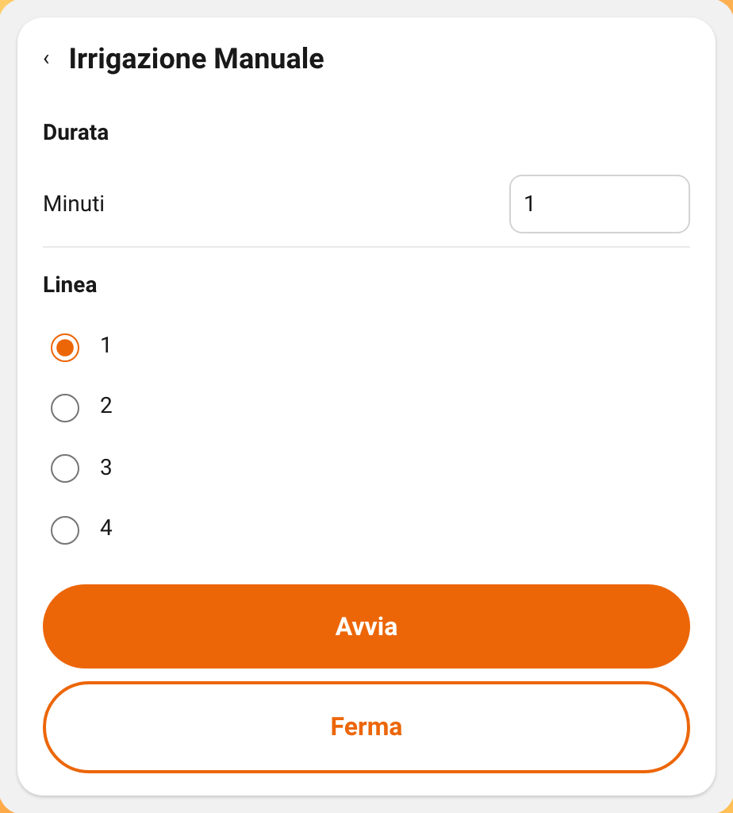
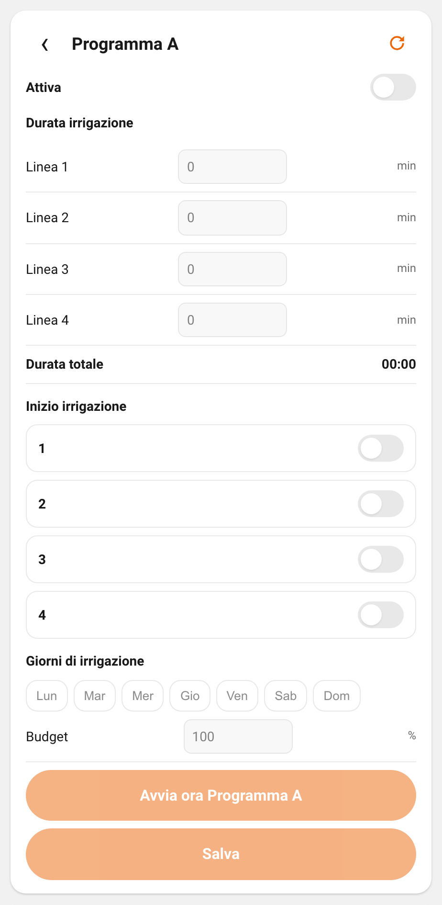

# Claber BT

[](https://github.com/hacs/integration)
[](https://github.com/bordeo/ha-claber-bt/releases)
[](https://github.com/bordeo/ha-claber-bt/actions/workflows/hassfest.yml)
[](https://github.com/bordeo/ha-claber-bt/actions/workflows/hacs.yml)
[](https://github.com/bordeo/ha-claber-bt/actions/workflows/pytest.yml)

Home Assistant custom integration and Lovelace card for Claber myAquaSystem Bluetooth irrigation devices.

[](https://my.home-assistant.io/redirect/hacs_repository/?owner=bordeo&repository=ha-claber-bt&category=integration)
[](https://my.home-assistant.io/redirect/config_flow_start/?domain=claber_bt)

## Features

- Passive BLE status for Hydro-4 BT and Rain Sensor BT (no background GATT)
- Hydro-4 line valves, manual duration, Stop, Auto mode, and Program A/B
- Batch program write (`claber_bt.write_program`) and "start program now" buttons
- Bundled Lovelace card (`custom:claber-card`) ships with the integration; no separate Lovelace resource
- Card UI in English by default; Italian when Home Assistant language is `it`

## Supported devices

This integration targets Claber's [myAquaSystem](https://www.claber.com/en/prodotti/in-evidenza/myaquasystem/) Bluetooth range, the connected family managed with the myClaber app. It should be compatible with myAquaSystem devices for that reason. Only Hydro-4 BT and Rain Sensor BT have been tested; the rest of the myAquaSystem range has not.

| Device | Model | Notes |
| --- | --- | --- |
| Hydro-4 BT | 90840 | Status plus manual and program commands |
| Rain Sensor BT | 90844 | Temperature, rain, battery |

## Requirements

- Home Assistant 2024.8+ with Bluetooth enabled, or
- An [ESPHome Bluetooth proxy](https://esphome.io/components/bluetooth_proxy/) (or another HA Bluetooth proxy) in range of the devices

The devices advertise as local name `Claber`. Keep them powered and within radio range of the adapter or proxy.

## Install (HACS custom repository)

1. HACS → Integrations → ⋮ → Custom repositories
2. Repository: `bordeo/ha-claber-bt`, category: Integration
3. Install Claber BT, then restart Home Assistant
4. Add the integration (button above, or Settings → Devices & services → Add integration → Claber BT)

The Lovelace card registers automatically. You do not need to add a frontend resource.

## Setup

1. Power on the Hydro-4 BT and/or Rain Sensor BT near your Bluetooth adapter or proxy
2. Add Claber BT. Discovered devices appear in the config flow.
3. Optional (Hydro-4): set a preferred Bluetooth source in the integration options if you use multiple adapters or proxies
4. Add the card to a dashboard:

```yaml
type: custom:claber-card
hydro_device: hydro_4_bt_aa_bb_cc_dd_ee_ff
rain_device: rain_sensor_bt_aa_bb_cc_dd_ee_ff   # optional
```

Each `*_device` value is the entity-id prefix from Developer Tools → States. If you see `sensor.hydro_4_bt_aa_bb_cc_dd_ee_ff_battery`, use `hydro_4_bt_aa_bb_cc_dd_ee_ff`.

## Entities and services

### Hydro-4 BT

| Type | Examples | Purpose |
| --- | --- | --- |
| Sensor | Battery, Active program, Irrigation ends at, Last seen, Signal strength | Passive status |
| Binary sensor | Raining, Rain sensor connected, Reachable, Battery warning | Passive flags |
| Valve | Linea 1–4 | Manual open/close (uses configured duration); shows watering state |
| Number | Durata manuale; Program A/B line minutes and budget | Manual duration and program edit |
| Switch | Auto mode; Program A/B enabled, weekdays, start slots | Auto and program bits |
| Time | Program A/B start times | Program schedule |
| Button | Stop; Leggi programmi; Avvia ora Programma A/B | Explicit GATT commands |

### Rain Sensor BT

| Type | Examples | Purpose |
| --- | --- | --- |
| Sensor | Temperature, 24h min/max, Battery, Last seen, Signal strength | Passive status |
| Binary sensor | Rain, Has connected, Has scanned | Passive flags |

### Services

| Service | Description |
| --- | --- |
| `claber_bt.manual_once` | One-shot manual start (line + minutes) or `stop_only`. Prefer valve and button entities for daily use. |
| `claber_bt.write_program` | One GATT session: read, merge fields for program A or B, write, then verify. Fields: `enabled`, `budget`, `days`, `lines`, `starts`. |

Program "start now" is exposed as buttons (and from the card), not as a separate service.

## Screenshots









## How it works

- State comes from passive BLE advertisements. Home Assistant or a Bluetooth proxy listens; the integration does not poll GATT for status.
- GATT is used only when you issue a command: open or close valves, Stop, read or write programs, start a program now, or call a service.
- Hydro command auth is derived from the device MAC, same approach as the official app. There is no PIN step.

## Safety

- Valve and program commands are manual only. This integration creates no automations and does not expose entities to HomeKit or Assist by itself.
- Ambiguous command ACKs are treated as failure. A successful disconnect does not prove water is flowing. Check on-site when it matters.
- Prefer the device Auto / Program A/B schedule for routine irrigation. Use Home Assistant for status and deliberate manual actions.

## Troubleshooting

| Symptom | Things to check |
| --- | --- |
| Device not discovered | Device powered? In range of HA Bluetooth or an ESPHome proxy? Advert name should be `Claber`. |
| Entities stay unknown / unavailable | Wait for fresh adverts after restart; proxies sometimes need a moment. Check Diagnostics on the config entry. |
| Commands fail / proxy errors | Prefer a connectable Bluetooth path; set Preferred Bluetooth source on the Hydro entry if you have multiple radios. |
| Card missing | Restart after install; hard-refresh the browser. The module is `/claber_bt/claber-card.js` (version query cache-bust). |
| Programs empty | Press Leggi programmi (or the refresh icon on the card) once. Programs are not read in the background. |

## Disclaimer

This project is not affiliated with, endorsed by, or related to Claber S.p.A. Device protocol details were observed from public BLE behaviour and the official mobile app. Use at your own risk around water and outdoor equipment.

## Contributing

See [CONTRIBUTING.md](CONTRIBUTING.md).

## License

[MIT](LICENSE)
